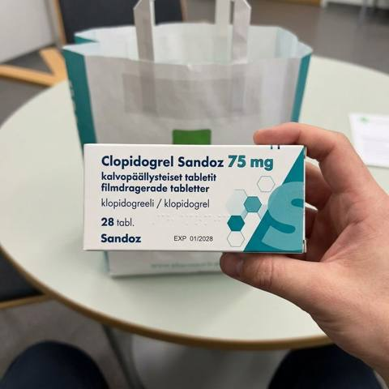
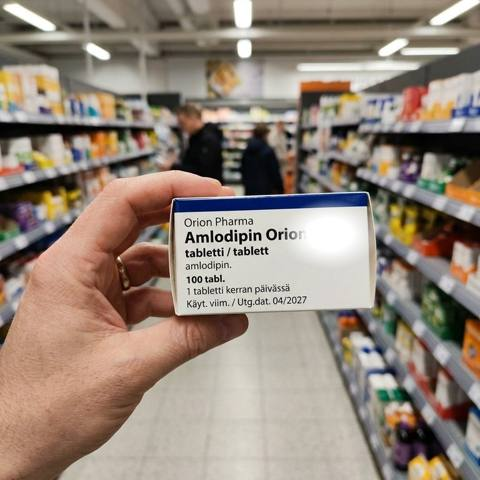
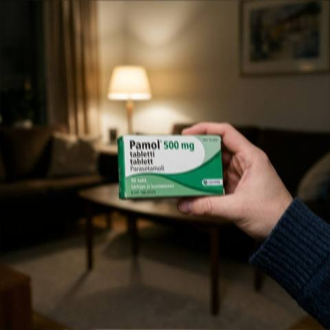

# HoldUp eval (v1)

_Generated 2026-11-14 19:06 by `eval/make_report.py` from `eval/out/results.json`._

Model under test: `gemini-3.8-flash` (thinking `low`), prompt and schema from `shared/` (hash `814770315c42`). Confident = confidence ≥ 0.8. Safety rules: server/src/safety.ts via npx tsx (STRENGTH_MIN_CONF from the module). All rates are k/n with 95% Wilson CIs; ECE and latency percentiles use bootstrap CIs. Reads are clustered (up to 10 images per label spec), so the per-read CIs are optimistic; where it matters, a per-spec bound is given too.

## Headline (synthetic set, v1)

- **Data:** 1740 images from 172 Gemini-generated label specs (1280 medicine images, 460 food images). 210 renders passed the legibility check; 6 were dropped as garbled; the rest failed for API reasons.
- **Strength confident-wrong: 0/1280 reads** (95% CI 0–0.30%; across 126 medicine specs, the zero-event bound per spec is ≤2.4%). Of all 788 strengths the model reported, **788/788 were right** (100.0% [99.5–100.0]).
- **Strength accuracy when readable:** 770/926 = 83.2% (95% CI 80.6–85.4%). The rest are abstentions, not errors: 156/926 = 16.8% (95% CI 14.6–19.4%).
- **Abstains when the strength is not visible** (crop, glare, back of box): 187/190 = 98.4% (95% CI 95.5–99.5%).
- **Unsafe reassurance, end-to-end with the shipped `safety.ts`:** 49/4730 = 1.04% (95% CI 0.78–1.37%). By category: {'expired_date_misread_or_unseen': 32, 'missed_allergen': 17}. None is a wrong-strength match. A further 47 matches on expired boxes carried the "couldn't read the expiry date" caveat.
- **Allergens (readable panel, model answered):** every declared allergen found in 222/246 = 90.2% (95% CI 85.9–93.4%); missed at least one with confidence ≥0.6 (the server's allergen threshold) in 22/246 = 8.9% (95% CI 6.0–13.2%).
- **Calibration:** strength ECE 0.058 [0.052–0.064] (n=788; the model is under-confident); all-field ECE 0.022 [0.018–0.028] (n=4406).
- **Latency** per verify call (one 768 px frame, gemini-3.8-flash, thinking low, n=1740): p50 3.43 s [3.41–3.46 s], p95 5.55 s [5.42–5.83 s].
- **Gemini as a workforce:** 2,300 calls in total, 4,868,332 input, 774,290 output and 825,374 thinking tokens (see the table at the end).

## Summary for the team (v1, synthetic only)

**Strength (the key field): 0 confident-wrong reads.** The model read 1,280 strength fields across clean and degraded photos. Every strength it reported was right: 0 wrong, at any confidence. When the strength was readable, it read it 83% of the time and abstained the rest. When the strength was cut off, under glare or on the back of the box, it abstained 98% of the time; the other 2% were correct readings, not guesses. Two adjustments were made before reaching this number, both listed in "How the numbers were adjudicated" below.

**The end-to-end verdict from the shipped `safety.ts` is not yet "almost zero": 49 unsafe reassurances in 4,730 verdicts (1.0%).** None of them is a medicine matched at the wrong strength. They fall into two groups:
- **17 missed allergens on food.** Most happen when the ingredients panel is partly cut off or under glare. The model returns the allergens it can see, with confidence 0.75–0.9, while its own readability score is 0.4–0.7 and it gives a "turn the pack" guidance. `safety.ts` then says "none of your allergens".
- **32 expired items reported as fine.** 30 are food whose best-before date was cropped out of view. The food "info" verdict doesn't say that the date couldn't be read, while the medicine path now does. 2 are medicines whose expiry *year* was misread under motion blur at confidence 0.85 (2025 read as 2028).

There are also 47 matches on an expired medicine box where the system said "I couldn't read the expiry date". The new rule works as intended there, so these are not counted as unsafe.

### Recommendations, with numbers measured by re-running the real `safety.ts`
1. **Food: don't say "none of your allergens" from a partial panel.** In `safety.ts` (or `toLabelRead`), when `kind = food` and `readability < 0.7` or a `guidance` is present, treat the allergens as unsure. Unsafe reassurance falls from **49 to 4 (1.0% to 0.1%)**, and the unsure rate rises only from 36.7% to 38.4%. This is variant A in the table below.
2. **Food: add the expiry caveat that medicines already have.** When `exp` is unknown, add "I couldn't read the date" to the food info verdict. That turns the remaining "expired, date not visible" cases into disclosed ones.
3. **Expiry trust threshold: 0.7 → 0.9, but only together with recommendation 2.**
   - Expiry is the weakest field under motion blur (41% read correctly, 11 confident-wrong). The model misreads 5↔8 and 5↔6 in the year.
   - Trusted-but-wrong expiry dates by threshold: 30 at 0.7, 20 at 0.8, **6 at 0.9**, 3 at 0.95. Coverage on readable dates falls from 77.5% to 72.3%.
   - On its own (variant B) this *raises* unsafe reassurances to 62. The low-confidence expired foods then become silent "info" verdicts, so do recommendation 2 first.
4. **Strength threshold: keep `STRENGTH_MIN_CONF = 0.8`.** No strength was wrong at any threshold from 0.5 to 0.95, so the threshold only trades coverage: 83.0% at 0.5, 80.0% at 0.8, 74.1% at 0.9. On strength the model is *under*-confident (100% accurate in every bin, ECE 0.058), so 0.8 is safe. Lowering it to 0.7 would gain about 2 points of coverage with no observed errors. I'd keep 0.8 until the real-photo set (v2) confirms.
5. **Prompt (`shared/verify_prompt.md`):**
   - Apply rule 2's digit-uncertainty clause (5/6/8) to `expiry` as well as strength: "if any digit of the year or month is uncertain, set expiry null".
   - For `allergens`: "if the ingredients list is cut off or partly unreadable, set allergens confidence ≤ 0.3".
   - Add the grains to the gluten mapping: "rye/ruis/råg, barley/ohra/korn, oats/kaura/havre, spelt → also add gluten". The clearest allergen miss was a Finnish rye bread (`food004`, TÄYSJYVÄRUISJAUHO, wholegrain rye flour): the model listed milk and sesame but not gluten, at confidence 0.9, on clean and rotated frames.
   - For product: keep the full product name ("Panadol Extra", not "Panadol"). Under crop the model sometimes reports only the brand at 0.95, and a sub-brand can change the ingredients.

### How the numbers were adjudicated
- Strength is scored as **"no wrong number"**: every amount and unit the model reports must be printed on the label.
  - 13 reads dropped a printed equivalent or secondary amount, for example "75 µg" for "75 µg (3000 IU)" or "500 mg + 800 IU" for "500 mg / 800 IU (20 mikrog)". They are counted as correct and listed separately as *incomplete*.
  - Under exact-sequence scoring those 13 would be "confident-wrong", but none of them contains a wrong digit.
- One ground-truth fix is in `eval/gt_overrides.json`. `med113` is printed "30 mg Fe + 70 mg Vit. C" while the spec said "30 mg", so the model's full reading was right.
- Ingredient answers without the salt form ("levothyroxine" for "levothyroxine sodium") count as correct, because the prompt asks for the INN without the salt.
- Allergens are scored strictly: the canonical set must match exactly. Extra allergens therefore count as wrong as well, which is why "allergens confident-wrong" is high. The safety-relevant figure is the **missed-allergen rate**: 22 of 246 answered reads of a readable panel missed at least one allergen with confidence ≥ 0.6. That is the allergen threshold in `safety.ts`.

## Details

### Dataset (images per condition)

| Condition | Images |
|---|---|
| back_of_box | 40 |
| clean | 170 |
| crop | 273 |
| defocus | 234 |
| glare | 246 |
| low_light | 270 |
| motion_blur | 246 |
| rotation | 261 |

Each front render gets clean plus 3 random degradation types × 3 severities. Back-of-box renders are evaluated clean.

### Per-field accuracy (all conditions)

Cells: rate [95% Wilson CI], with the denominator in the column header's n.

| Field | n reads (specs) | Accuracy, readable (n) | Abstain, readable | Abstain, not visible (n) | Confident-wrong ≥0.8, all reads |
|---|---|---|---|---|---|
| product | 1738 (172) | 83.1% [81.0–85.0] (n=1358) | 15.2% [13.4–17.2] | 90.8% [85.5–94.2] (n=173) | **42/1738** 2.4% [1.8–3.2] |
| ingredient | 1200 (121) | 88.0% [85.6–90.1] (n=809) | 12.0% [9.9–14.4] | 73.5% [67.1–79.0] (n=211) | **12/1200** 1.0% [0.6–1.7] |
| strength | 1280 (126) | 83.2% [80.6–85.4] (n=926) | 16.8% [14.6–19.4] | 98.4% [95.5–99.5] (n=190) | **0/1280** 0.0% [0.0–0.3] |
| dosing | 1090 (114) | 87.9% [80.0–92.9] (n=99) | 12.1% [7.1–20.0] | 98.4% [97.4–99.0] (n=978) | **16/1090** 1.5% [0.9–2.4] |
| expiry | 1737 (172) | 78.0% [75.7–80.2] (n=1265) | 19.8% [17.7–22.1] | 93.7% [89.8–96.1] (n=237) | **20/1737** 1.2% [0.8–1.8] |
| allergens | 460 (46) | 76.6% [71.3–81.2] (n=282) | 12.8% [9.4–17.2] | 49.2% [37.1–61.4] (n=61) | **66/460** 14.3% [11.4–17.9] |
| barcode | 1737 (172) | 91.9% [78.7–97.2] (n=37) | 2.7% [0.5–13.8] | 100.0% [99.8–100.0] (n=1700) | **2/1737** 0.1% [0.0–0.4] |

_Readable_ means the field is legible in the image, according to the render check and the degradation model. _Not visible_ means it is cropped, under glare, too blurred or on the back of the box; the honest answer there is null.

### Strength by degradation and severity

| Condition | sev | n | Accuracy, readable (n) | Abstain, partial or hidden (n) | Wrong, all | Confident-wrong |
|---|---|---|---|---|---|---|
| clean | 0 | 124 | 100.0% [97.0–100.0] (n=124) | – (n=0) | 0/124 | 0/124 |
| rotation | 1 | 61 | 100.0% [94.1–100.0] (n=61) | – (n=0) | 0/61 | 0/61 |
| rotation | 2 | 61 | 100.0% [94.1–100.0] (n=61) | – (n=0) | 0/61 | 0/61 |
| rotation | 3 | 61 | 98.4% [91.3–99.7] (n=61) | – (n=0) | 0/61 | 0/61 |
| defocus | 1 | 55 | 100.0% [93.5–100.0] (n=55) | – (n=0) | 0/55 | 0/55 |
| defocus | 2 | 55 | 65.5% [52.2–76.6] (n=55) | – (n=0) | 0/55 | 0/55 |
| defocus | 3 | 55 | 2.3% [0.4–11.8] (n=44) | 100.0% [74.1–100.0] (n=11) | 0/55 | 0/55 |
| motion_blur | 1 | 63 | 96.8% [89.1–99.1] (n=63) | – (n=0) | 0/63 | 0/63 |
| motion_blur | 2 | 63 | 37.1% [26.2–49.5] (n=62) | 100.0% [20.6–100.0] (n=1) | 0/63 | 0/63 |
| motion_blur | 3 | 63 | 0.0% [0.0–43.5] (n=5) | 96.6% [88.3–99.0] (n=58) | 0/63 | 0/63 |
| low_light | 1 | 68 | 100.0% [94.7–100.0] (n=68) | – (n=0) | 0/68 | 0/68 |
| low_light | 2 | 68 | 95.6% [87.8–98.5] (n=68) | – (n=0) | 0/68 | 0/68 |
| low_light | 3 | 68 | 32.3% [22.2–44.4] (n=65) | 100.0% [43.9–100.0] (n=3) | 0/68 | 0/68 |
| glare | 1 | 58 | 100.0% [93.8–100.0] (n=58) | – (n=0) | 0/58 | 0/58 |
| glare | 2 | 58 | – (n=0) | 96.6% [88.3–99.0] (n=58) | 0/58 | 0/58 |
| glare | 3 | 58 | – (n=0) | 96.6% [88.3–99.0] (n=58) | 0/58 | 0/58 |
| crop | 1 | 67 | 100.0% [89.6–100.0] (n=33) | 82.4% [66.5–91.7] (n=34) | 0/67 | 0/67 |
| crop | 2 | 67 | 100.0% [87.1–100.0] (n=26) | 92.7% [80.6–97.5] (n=41) | 0/67 | 0/67 |
| crop | 3 | 67 | 100.0% [81.6–100.0] (n=17) | 94.0% [83.8–97.9] (n=50) | 0/67 | 0/67 |
| back_of_box | 0 | 40 | – (n=0) | 100.0% [91.2–100.0] (n=40) | 0/40 | 0/40 |

### Expiry by degradation and severity

| Condition | sev | n | Accuracy, readable (n) | Abstain, partial or hidden (n) | Wrong, all | Confident-wrong |
|---|---|---|---|---|---|---|
| clean | 0 | 170 | 98.2% [94.8–99.4] (n=166) | 50.0% [15.0–85.0] (n=4) | 1/170 | 1/170 |
| rotation | 1 | 87 | 98.8% [93.6–99.8] (n=84) | 66.7% [20.8–93.8] (n=3) | 1/87 | 0/87 |
| rotation | 2 | 87 | 98.8% [93.6–99.8] (n=84) | 66.7% [20.8–93.8] (n=3) | 1/87 | 0/87 |
| rotation | 3 | 87 | 98.8% [93.3–99.8] (n=81) | 33.3% [9.7–70.0] (n=6) | 1/87 | 0/87 |
| defocus | 1 | 78 | 85.7% [76.2–91.8] (n=77) | 100.0% [20.6–100.0] (n=1) | 2/78 | 2/78 |
| defocus | 2 | 78 | 19.5% [12.2–29.7] (n=77) | 100.0% [20.6–100.0] (n=1) | 3/78 | 0/78 |
| defocus | 3 | 78 | 0.0% [0.0–14.3] (n=23) | 100.0% [93.5–100.0] (n=55) | 0/78 | 0/78 |
| motion_blur | 1 | 82 | 67.1% [56.1–76.5] (n=79) | 100.0% [43.9–100.0] (n=3) | 9/82 | 6/82 |
| motion_blur | 2 | 82 | 8.2% [3.2–19.2] (n=49) | 93.9% [80.4–98.3] (n=33) | 7/82 | 5/82 |
| motion_blur | 3 | 82 | 0.0% [0.0–24.2] (n=12) | 97.1% [90.2–99.2] (n=70) | 1/82 | 0/82 |
| low_light | 1 | 90 | 96.6% [90.5–98.8] (n=88) | 100.0% [34.2–100.0] (n=2) | 0/90 | 0/90 |
| low_light | 2 | 90 | 63.6% [53.2–72.9] (n=88) | 100.0% [34.2–100.0] (n=2) | 5/90 | 3/90 |
| low_light | 3 | 90 | 0.0% [0.0–7.1] (n=50) | 100.0% [91.2–100.0] (n=40) | 0/90 | 0/90 |
| glare | 1 | 82 | 97.5% [91.3–99.3] (n=80) | 50.0% [9.4–90.5] (n=2) | 0/82 | 0/82 |
| glare | 2 | 82 | 97.3% [90.5–99.2] (n=73) | 55.6% [26.7–81.1] (n=9) | 3/82 | 1/82 |
| glare | 3 | 82 | 95.7% [88.0–98.5] (n=69) | 53.8% [29.1–76.8] (n=13) | 2/82 | 1/82 |
| crop | 1 | 91 | 100.0% [90.4–100.0] (n=36) | 76.4% [63.6–85.6] (n=55) | 1/91 | 1/91 |
| crop | 2 | 91 | 95.8% [79.8–99.3] (n=24) | 83.6% [72.9–90.6] (n=67) | 1/91 | 0/91 |
| crop | 3 | 91 | 100.0% [86.7–100.0] (n=25) | 90.9% [81.5–95.8] (n=66) | 1/91 | 0/91 |
| back_of_box | 0 | 37 | – (n=0) | 100.0% [90.6–100.0] (n=37) | 0/37 | 0/37 |

### Allergens by degradation and severity

| Condition | sev | n | Accuracy, readable (n) | Abstain, partial or hidden (n) | Wrong, all | Confident-wrong |
|---|---|---|---|---|---|---|
| clean | 0 | 46 | 95.7% [85.5–98.8] (n=46) | – (n=0) | 2/46 | 2/46 |
| rotation | 1 | 26 | 88.5% [71.0–96.0] (n=26) | – (n=0) | 3/26 | 3/26 |
| rotation | 2 | 26 | 84.6% [66.5–93.8] (n=26) | – (n=0) | 4/26 | 4/26 |
| rotation | 3 | 26 | 83.3% [64.2–93.3] (n=24) | 0.0% [0.0–65.8] (n=2) | 4/26 | 4/26 |
| defocus | 1 | 23 | 91.3% [73.2–97.6] (n=23) | – (n=0) | 2/23 | 2/23 |
| defocus | 2 | 23 | 13.6% [4.8–33.3] (n=22) | 100.0% [20.6–100.0] (n=1) | 4/23 | 0/23 |
| defocus | 3 | 23 | 0.0% [0.0–79.3] (n=1) | 100.0% [85.1–100.0] (n=22) | 0/23 | 0/23 |
| motion_blur | 1 | 19 | 94.7% [75.4–99.1] (n=19) | – (n=0) | 0/19 | 0/19 |
| motion_blur | 2 | 19 | 28.6% [8.2–64.1] (n=7) | 83.3% [55.2–95.3] (n=12) | 4/19 | 1/19 |
| motion_blur | 3 | 19 | 0.0% [0.0–79.3] (n=1) | 94.4% [74.2–99.0] (n=18) | 1/19 | 0/19 |
| low_light | 1 | 22 | 95.5% [78.2–99.2] (n=22) | – (n=0) | 1/22 | 1/22 |
| low_light | 2 | 22 | 63.6% [43.0–80.3] (n=22) | – (n=0) | 5/22 | 1/22 |
| low_light | 3 | 22 | 0.0% [0.0–27.8] (n=10) | 100.0% [75.8–100.0] (n=12) | 0/22 | 0/22 |
| glare | 1 | 24 | 91.7% [74.2–97.7] (n=24) | – (n=0) | 2/24 | 2/24 |
| glare | 2 | 24 | 100.0% [20.6–100.0] (n=1) | 21.7% [9.7–41.9] (n=23) | 10/24 | 8/24 |
| glare | 3 | 24 | 0.0% [0.0–79.3] (n=1) | 43.5% [25.6–63.2] (n=23) | 11/24 | 7/24 |
| crop | 1 | 24 | 80.0% [37.5–96.4] (n=5) | 0.0% [0.0–16.8] (n=19) | 5/24 | 5/24 |
| crop | 2 | 24 | 100.0% [20.6–100.0] (n=1) | 8.7% [2.4–26.8] (n=23) | 17/24 | 16/24 |
| crop | 3 | 24 | 0.0% [0.0–79.3] (n=1) | 30.4% [15.6–50.9] (n=23) | 14/24 | 10/24 |

### Calibration: strength

| Confidence bin | n | Mean confidence | Accuracy [95% CI] |
|---|---|---|---|
| [0.00,0.50) | 3 | 0.3 | 100.0% [43.9–100.0] |
| [0.50,0.60) | 3 | 0.5 | 100.0% [43.9–100.0] |
| [0.60,0.70) | 11 | 0.605 | 100.0% [74.1–100.0] |
| [0.70,0.80) | 17 | 0.715 | 100.0% [81.6–100.0] |
| [0.80,0.90) | 55 | 0.835 | 100.0% [93.5–100.0] |
| [0.90,0.95) | 37 | 0.901 | 100.0% [90.6–100.0] |
| [0.95,1.00] | 662 | 0.97 | 100.0% [99.4–100.0] |

ECE over 788 answered reads: **0.058** (bootstrap 95% CI [0.052–0.064])

### Calibration: all fields

| Confidence bin | n | Mean confidence | Accuracy [95% CI] |
|---|---|---|---|
| [0.00,0.50) | 12 | 0.35 | 66.7% [39.1–86.2] |
| [0.50,0.60) | 23 | 0.5 | 69.6% [49.1–84.4] |
| [0.60,0.70) | 40 | 0.603 | 80.0% [65.2–89.5] |
| [0.70,0.80) | 180 | 0.71 | 76.7% [70.0–82.2] |
| [0.80,0.90) | 396 | 0.838 | 83.6% [79.6–86.9] |
| [0.90,0.95) | 286 | 0.901 | 88.5% [84.2–91.7] |
| [0.95,1.00] | 3469 | 0.964 | 98.3% [97.8–98.7] |

ECE over 4406 answered reads: **0.022** (bootstrap 95% CI [0.018–0.028])

### Choosing the 'unsure' threshold for strength

| Trust threshold t | Readable values accepted (coverage, n=926) | Trusted reads | Trusted but wrong [95% CI of rate] |
|---|---|---|---|
| 0.5 | 83.0% | 785 | 0/785 0.0% [0.0–0.5] |
| 0.6 | 82.8% | 782 | 0/782 0.0% [0.0–0.5] |
| 0.7 | 81.9% | 771 | 0/771 0.0% [0.0–0.5] |
| 0.8 | 80.0% | 754 | 0/754 0.0% [0.0–0.5] |
| 0.85 | 78.2% | 737 | 0/737 0.0% [0.0–0.5] |
| 0.9 | 74.1% | 699 | 0/699 0.0% [0.0–0.6] |
| 0.95 | 70.2% | 662 | 0/662 0.0% [0.0–0.6] |

### End-to-end safety verdict

Each image is checked against 2–3 profiles: for medicines, the item on the list at the same strength, on the list at a different strength, and not on the list; for food, allergic to an allergen it contains, and allergic to one it doesn't. _Unsafe reassurance_ means the true verdict is a warning (wrong strength, not your medicine, allergen, expired) but the system said match or no-allergen. The counterfactual rows apply a policy change to the model's read and then run the same `safety.ts`.

| Safety rules | Verdicts n | Correct vs truth | Unsure | **Unsafe reassurance** | Expired, match with caveat |
|---|---|---|---|---|---|
| **server safety.ts (as shipped)** | 4730 | 61.0% [59.6–62.4] | 36.7% [35.4–38.1] | **49/4730** 1.0% [0.8–1.4] | 47 |
| counterfactual A_food_partial_panel_unsure | 4730 | 60.3% [58.9–61.7] | 38.4% [37.0–39.8] | **4/4730** 0.1% [0.0–0.2] | 47 |
| counterfactual B_expiry_trust_0.9 | 4730 | 60.1% [58.7–61.5] | 36.8% [35.5–38.2] | **62/4730** 1.3% [1.0–1.7] | 78 |
| counterfactual A+B | 4730 | 59.4% [58.0–60.8] | 38.7% [37.3–40.1] | **6/4730** 0.1% [0.1–0.3] | 78 |

Per scenario (server rules as shipped):

| Scenario | n | Correct | Unsure | Unsafe |
|---|---|---|---|---|
| allergic_to_absent | 460 | 63.9% [59.4–68.2] | 28.3% [24.3–32.5] | 30/460 6.5% [4.6–9.2] |
| allergic_to_contained | 430 | 68.6% [64.1–72.8] | 27.4% [23.4–31.9] | 17/430 4.0% [2.5–6.2] |
| not_on_list | 1280 | 73.9% [71.4–76.2] | 26.1% [23.8–28.6] | 0/1280 0.0% [0.0–0.3] |
| on_list_other_strength | 1280 | 54.7% [52.0–57.4] | 45.2% [42.5–48.0] | 0/1280 0.0% [0.0–0.3] |
| on_list_same_strength | 1280 | 50.8% [48.0–53.5] | 45.2% [42.5–48.0] | 2/1280 0.2% [0.0–0.6] |

By condition (server rules as shipped):

| Condition | Verdicts n | Correct vs truth | Unsure | Unsafe reassurance |
|---|---|---|---|---|
| clean | 461 | 99.8% [98.8–100.0] | 0.0% [0.0–0.8] | 0/461 0.0% [0.0–0.8] |
| rotation | 699 | 98.3% [97.0–99.0] | 0.6% [0.2–1.5] | 3/699 0.4% [0.1–1.2] |
| defocus | 630 | 44.6% [40.8–48.5] | 53.5% [49.6–57.4] | 1/630 0.2% [0.0–0.9] |
| motion_blur | 678 | 39.8% [36.2–43.6] | 58.4% [54.7–62.1] | 6/678 0.9% [0.4–1.9] |
| low_light | 738 | 65.9% [62.4–69.2] | 32.2% [29.0–35.7] | 4/738 0.5% [0.2–1.4] |
| glare | 660 | 57.9% [54.1–61.6] | 41.5% [37.8–45.3] | 2/660 0.3% [0.1–1.1] |
| crop | 744 | 42.5% [39.0–46.0] | 50.0% [46.4–53.6] | 33/744 4.4% [3.2–6.2] |
| back_of_box | 120 | 2.5% [0.8–7.1] | 97.5% [92.9–99.2] | 0/120 0.0% [0.0–3.1] |

Unsafe reassurance cases (server rules as shipped):

| Image (eval/synthetic/images/) | Category | Scenario | Truth (why) | System said | System reasons |
|---|---|---|---|---|---|
| `med012__motion_blur_1.jpg` | expired_date_misread_or_unseen | on_list_same_strength | warning (expired 2025-09) | match | matches m1; taken today: 0/1 |
| `med120__low_light_2.jpg` | expired_date_misread_or_unseen | on_list_same_strength | warning (expired 2026-06) | match | matches m1; taken today: 0/1 |
| `food002__crop_2.jpg` | expired_date_misread_or_unseen | allergic_to_absent | warning (expired 2025-06-18) | info | no listed allergen matches your profile |
| `food007__crop_1.jpg` | expired_date_misread_or_unseen | allergic_to_absent | warning (expired 2026-10-15) | info | no listed allergen matches your profile |
| `food007__crop_2.jpg` | missed_allergen | allergic_to_contained | warning (may contain gluten (allergy: gluten); expired 2026-10-15) | info | no listed allergen matches your profile |
| `food007__crop_2.jpg` | expired_date_misread_or_unseen | allergic_to_absent | warning (expired 2026-10-15) | info | no listed allergen matches your profile |
| `food016__crop_2.jpg` | expired_date_misread_or_unseen | allergic_to_absent | warning (expired 2024-11-15) | info | no listed allergen matches your profile |
| `food016__crop_3.jpg` | expired_date_misread_or_unseen | allergic_to_absent | warning (expired 2024-11-15) | info | no listed allergen matches your profile |
| `food019__crop_2.jpg` | missed_allergen | allergic_to_contained | warning (contains crustaceans (allergy: crustaceans); expired 2024-03-02) | info | no listed allergen matches your profile |
| `food019__crop_2.jpg` | expired_date_misread_or_unseen | allergic_to_absent | warning (expired 2024-03-02) | info | no listed allergen matches your profile |
| `food018__crop_1.jpg` | expired_date_misread_or_unseen | allergic_to_absent | warning (expired 2025-08-20) | info | no listed allergen matches your profile |
| `food025__crop_2.jpg` | expired_date_misread_or_unseen | allergic_to_absent | warning (expired 2026-04-12) | info | no listed allergen matches your profile |
| `food026__crop_2.jpg` | missed_allergen | allergic_to_contained | warning (may contain celery (allergy: celery); expired 2025-08-04) | info | no listed allergen matches your profile |
| `food026__crop_2.jpg` | expired_date_misread_or_unseen | allergic_to_absent | warning (expired 2025-08-04) | info | no listed allergen matches your profile |
| `food032__motion_blur_2.jpg` | expired_date_misread_or_unseen | allergic_to_absent | warning (expired 2024-04-18) | info | no listed allergen matches your profile |
| `food032__motion_blur_3.jpg` | expired_date_misread_or_unseen | allergic_to_absent | warning (expired 2024-04-18) | info | no listed allergen matches your profile |
| `food032__crop_1.jpg` | expired_date_misread_or_unseen | allergic_to_absent | warning (expired 2024-04-18) | info | no listed allergen matches your profile |
| `food032__crop_3.jpg` | expired_date_misread_or_unseen | allergic_to_absent | warning (expired 2024-04-18) | info | no listed allergen matches your profile |
| `food027__low_light_2.jpg` | missed_allergen | allergic_to_contained | warning (contains crustaceans (allergy: crustaceans)) | info | no listed allergen matches your profile |
| `food035__crop_1.jpg` | expired_date_misread_or_unseen | allergic_to_absent | warning (expired 2026-03-15) | info | no listed allergen matches your profile |
| `food035__crop_2.jpg` | missed_allergen | allergic_to_contained | warning (contains gluten (allergy: gluten); expired 2026-03-15) | info | no listed allergen matches your profile |
| `food035__crop_2.jpg` | expired_date_misread_or_unseen | allergic_to_absent | warning (expired 2026-03-15) | info | no listed allergen matches your profile |
| `food037__defocus_2.jpg` | expired_date_misread_or_unseen | allergic_to_absent | warning (expired 2024-10-05) | info | no listed allergen matches your profile |
| `food038__glare_2.jpg` | missed_allergen | allergic_to_contained | warning (may contain lupin (allergy: lupin)) | info | no listed allergen matches your profile |
| `food040__crop_2.jpg` | expired_date_misread_or_unseen | allergic_to_absent | warning (expired 2024-11-04) | info | no listed allergen matches your profile |
| `food040__crop_3.jpg` | expired_date_misread_or_unseen | allergic_to_absent | warning (expired 2024-11-04) | info | no listed allergen matches your profile |
| `food042__crop_2.jpg` | missed_allergen | allergic_to_contained | warning (contains gluten (allergy: gluten)) | info | no listed allergen matches your profile |
| `food041__motion_blur_2.jpg` | expired_date_misread_or_unseen | allergic_to_absent | warning (expired 2026-08-15) | info | no listed allergen matches your profile |
| `food049__crop_1.jpg` | expired_date_misread_or_unseen | allergic_to_absent | warning (expired 2025-06-03) | info | no listed allergen matches your profile |
| `food047__crop_1.jpg` | expired_date_misread_or_unseen | allergic_to_absent | warning (expired 2024-09-19) | info | no listed allergen matches your profile |
| `food047__crop_2.jpg` | missed_allergen | allergic_to_contained | warning (contains gluten (allergy: gluten); expired 2024-09-19) | info | no listed allergen matches your profile |
| `food047__crop_2.jpg` | expired_date_misread_or_unseen | allergic_to_absent | warning (expired 2024-09-19) | info | no listed allergen matches your profile |
| `food004__rotation_1.jpg` | missed_allergen | allergic_to_contained | warning (contains gluten (allergy: gluten)) | info | no listed allergen matches your profile |
| `food004__rotation_2.jpg` | missed_allergen | allergic_to_contained | warning (contains gluten (allergy: gluten)) | info | no listed allergen matches your profile |
| `food004__rotation_3.jpg` | missed_allergen | allergic_to_contained | warning (contains gluten (allergy: gluten)) | info | no listed allergen matches your profile |
| `food004__crop_1.jpg` | missed_allergen | allergic_to_contained | warning (contains gluten (allergy: gluten)) | info | no listed allergen matches your profile |
| `food004__low_light_2.jpg` | missed_allergen | allergic_to_contained | warning (contains gluten (allergy: gluten)) | info | no listed allergen matches your profile |
| `food010__crop_1.jpg` | missed_allergen | allergic_to_contained | warning (may contain mustard (allergy: mustard); expired 2025-07-02) | info | no listed allergen matches your profile |
| `food010__crop_1.jpg` | expired_date_misread_or_unseen | allergic_to_absent | warning (expired 2025-07-02) | info | no listed allergen matches your profile |
| `food010__crop_2.jpg` | missed_allergen | allergic_to_contained | warning (may contain mustard (allergy: mustard); expired 2025-07-02) | info | no listed allergen matches your profile |

### Confident-wrong examples (first 30, strength first)

| Image | Field | GT status | Truth | Read | Conf |
|---|---|---|---|---|---|
| `food002__glare_3` | allergens | hidden | ['egg', 'gluten', 'milk', 'soy', 'tree_nuts'] | ['may contain: milk', 'may contain: soy', 'may contain: hazelnut'] | 0.9 |
| `food002__crop_1` | allergens | partial | ['egg', 'gluten', 'milk', 'soy', 'tree_nuts'] | ['oat', 'may contain: milk', 'may contain: soy', 'may contain: hazelnut'] | 0.9 |
| `food002__crop_2` | allergens | partial | ['egg', 'gluten', 'milk', 'soy', 'tree_nuts'] | ['oat', 'gluten', 'egg'] | 0.95 |
| `food007__crop_2` | allergens | partial | ['gluten', 'milk', 'soy'] | ['milk', 'soy'] | 0.9 |
| `food011__rotation_1` | allergens | visible | ['peanut', 'sesame', 'tree_nuts'] | ['sesame', 'may contain: peanut'] | 0.95 |
| `food011__rotation_2` | allergens | visible | ['peanut', 'sesame', 'tree_nuts'] | ['sesame', 'may contain: peanut'] | 0.9 |
| `food011__rotation_3` | allergens | visible | ['peanut', 'sesame', 'tree_nuts'] | ['sesame', 'may contain: peanut'] | 0.9 |
| `food011__defocus_1` | allergens | visible | ['peanut', 'sesame', 'tree_nuts'] | ['sesame', 'may contain: peanut'] | 0.9 |
| `food016__crop_3` | allergens | partial | ['peanut', 'sesame'] | ['peanut'] | 0.95 |
| `food020__glare_2` | allergens | partial | ['milk', 'peanut', 'soy', 'tree_nuts'] | ['milk'] | 0.85 |
| `food019__crop_2` | allergens | partial | ['crustaceans', 'egg', 'fish', 'gluten', 'molluscs', 'soy'] | ['fish', 'wheat', 'gluten', 'egg', 'may contain: soy', 'may contain: mollusc'] | 0.9 |
| `food019__crop_3` | allergens | hidden | ['crustaceans', 'egg', 'fish', 'gluten', 'molluscs', 'soy'] | ['may contain: soy', 'may contain: mollusc'] | 0.95 |
| `food018__clean_0` | allergens | visible | ['sesame'] | ['sesame', 'may contain: nuts', 'may contain: gluten'] | 0.95 |
| `food018__glare_1` | allergens | visible | ['sesame'] | ['sesame', 'may contain: nuts', 'may contain: gluten'] | 0.95 |
| `food018__glare_2` | allergens | partial | ['sesame'] | ['sesame', 'may contain: nuts', 'may contain: gluten'] | 0.9 |
| `food018__glare_3` | allergens | hidden | ['sesame'] | ['sesame', 'may contain: nuts', 'may contain: gluten'] | 0.85 |
| `food018__rotation_1` | allergens | visible | ['sesame'] | ['sesame', 'may contain: nuts', 'may contain: gluten'] | 0.95 |
| `food018__rotation_2` | allergens | visible | ['sesame'] | ['sesame', 'may contain: nuts', 'may contain: gluten'] | 0.95 |
| `food018__rotation_3` | allergens | visible | ['sesame'] | ['sesame', 'may contain: nuts', 'may contain: gluten'] | 0.95 |
| `food018__crop_2` | allergens | hidden | ['sesame'] | ['may contain: nut', 'may contain: gluten'] | 0.95 |
| `food017__glare_2` | allergens | partial | ['egg', 'gluten', 'soy'] | ['may contain: soy', 'may contain: egg'] | 0.85 |
| `food017__glare_3` | allergens | hidden | ['egg', 'gluten', 'soy'] | ['may contain: soy', 'may contain: egg'] | 0.85 |
| `food021__glare_3` | allergens | hidden | ['gluten', 'milk', 'mustard'] | ['may contain: milk', 'may contain: mustard'] | 0.85 |
| `food022__crop_2` | allergens | partial | ['milk', 'peanut', 'soy', 'tree_nuts'] | ['milk', 'soy', 'may contain: tree nuts'] | 0.8 |
| `food022__crop_3` | allergens | hidden | ['milk', 'peanut', 'soy', 'tree_nuts'] | ['milk', 'whey', 'lactose'] | 0.85 |
| `food024__glare_2` | allergens | partial | ['celery', 'egg', 'gluten', 'milk', 'mustard', 'soy'] | ['wheat', 'gluten', 'may contain: milk', 'may contain: egg', 'may contain: mustard', 'may contain: soy'] | 0.9 |
| `food025__glare_2` | allergens | partial | ['egg', 'mustard', 'sulphites'] | ['mustard', 'egg'] | 0.8 |
| `food025__crop_3` | allergens | hidden | ['egg', 'mustard', 'sulphites'] | ['egg', 'sulfite'] | 0.95 |
| `food026__crop_2` | allergens | partial | ['celery', 'crustaceans', 'fish', 'gluten', 'milk'] | ['wheat', 'milk', 'fish'] | 0.85 |
| `food032__motion_blur_2` | allergens | visible | ['peanut', 'tree_nuts'] | ['peanut'] | 0.85 |

### Strength reads with the right numbers but a printed equivalent dropped (13)

| Image | Printed | Read | Conf |
|---|---|---|---|
| `med048__clean_0` | 75 µg (3000 IU) | 75 µg | 0.95 |
| `med048__motion_blur_1` | 75 µg (3000 IU) | 75 mcg | 0.9 |
| `med048__rotation_1` | 75 µg (3000 IU) | 75 µg | 0.9 |
| `med048__rotation_2` | 75 µg (3000 IU) | 75 000000003000 IU | 0.3 |
| `med048__rotation_3` | 75 µg (3000 IU) | 75 µg | 0.95 |
| `med048__crop_2` | 75 µg (3000 IU) | 3000 IU | 0.95 |
| `med051__clean_0` | 500 mg / 800 IU (20 mikrog) | 500 mg + 800 IU | 0.95 |
| `med051__motion_blur_1` | 500 mg / 800 IU (20 mikrog) | 500 mg + 800 IU | 0.9 |
| `med051__low_light_1` | 500 mg / 800 IU (20 mikrog) | 500 mg + 800 IU | 0.95 |
| `med051__low_light_2` | 500 mg / 800 IU (20 mikrog) | 500 mg + 800 IU | 0.85 |
| `med051__rotation_1` | 500 mg / 800 IU (20 mikrog) | 500 mg + 800 IU | 0.95 |
| `med051__rotation_2` | 500 mg / 800 IU (20 mikrog) | 500 mg + 800 IU | 0.95 |
| `med051__rotation_3` | 500 mg / 800 IU (20 mikrog) | 500 mg + 800 IU | 0.95 |

## Real photos

_Pending: photos land in `eval/real/` with `labels.csv` (v2)._

## Example images

_Clean read: Clopidogrel Sandoz 75 mg read correctly_

_Glare over the strength: the model returns strength null and says 'Tilt it away from the light'_

_Failure mode: under motion blur, EXP 09/2025 was read as 2028-09 at confidence 0.85_

## Gemini as a workforce: calls and tokens

| Workforce step | Model | Calls (ok) | Input tokens | Output tokens | Thinking tokens |
|---|---|---|---|---|---|
| eval.verify_label | gemini-3.8-flash | 1740 (1740) | 4,460,263 | 228,175 | 63,840 |
| gen_images.check | gemini-3.8-flash | 270 (232) | 350,260 | 102,526 | 757,303 |
| gen_images.render | gemini-3-pro-image | 18 (18) | 3,945 | 25,116 | 4,231 |
| gen_images.render | gemini-3.1-flash-image | 246 (239) | 47,061 | 347,707 | 0 |
| gen_specs | gemini-3.8-flash | 26 (26) | 6,803 | 70,766 | 0 |
| **total** | | **2,300** | **4,868,332** | **774,290** | **825,374** |

This covers every Gemini call made for this eval: spec generation, image rendering, the render check and the verify sweep, including retries and the calls made before the network outage. No Batch API was used.

## Method

1. `eval/gen_specs.py`: gemini-3.8-flash writes ground-truth label specs: medicine boxes and bottles, including Finnish/Swedish packs, and food packs with allergen synonyms and trace statements.
2. `eval/gen_images.py`: gemini-3.1-flash-image renders a first-person photo of a hand holding each item, falling back to gemini-3-pro-image. A separate check call (gemini-3.8-flash, thinking high, given the spec) marks each field as legible and matching, and returns its bounding box. A render whose key fields come out garbled is re-rendered once and then dropped; minor fields that don't match the spec are excluded from scoring. A subset of medicines also gets a back-of-box render.
3. `eval/degrade.py`: motion blur, defocus, rotation, partial crop, glare and low light at 3 severities. Each field's ground-truth status (readable, partial or not visible) is updated from its bounding box and text height.
4. `eval/run_eval.py`: runs the product's `shared/verify_prompt.md` and `shared/label_schema.json` exactly as `server/src/verify.ts` does (`$ref`s inlined, thinking low, max 4096 output tokens, "Read this label."), one 768 px frame per call. It applies the server's `toLabelRead` coercion, scores the fields with normalisation (units, dates, allergen synonyms, salt forms) and runs the real `server/src/safety.ts` through `npx tsx`.
5. Ground-truth fixes, adjudicated by eye, are in `eval/gt_overrides.json` (currently one).

Caveats:
- The render check uses the same model family as the model under test (gemini-3.1-pro-preview returns 404 on our key), so the 'readable' labels lean on Gemini's own reading of the clean render, which may make the ground truth easier.
- Degradation visibility is a heuristic based on text height and box overlap.
- All images are synthetic. The real photos (v2) check both points above.
